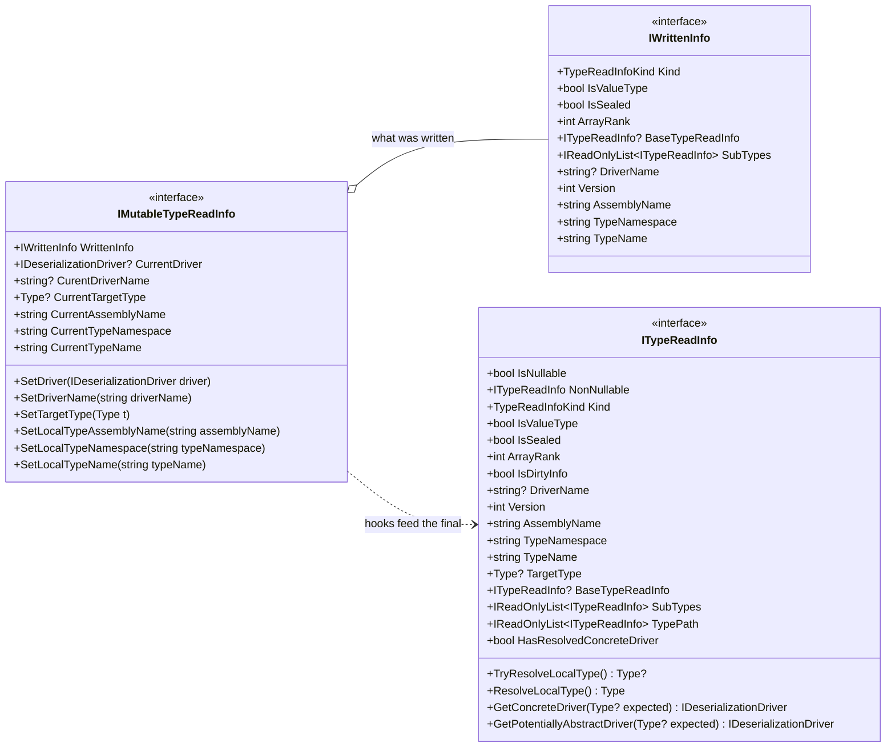

# Deserialization: switching types and type mutations

How what was written is read back into the current code: the serializer, deserializer and their contexts
are introduced in [Serialization](../Serialization/README.md).

## When the Type to serialize is not the same as the Type to deserialize
Before speaking of Type mutations, this scenario covers there is a simple case where you have a complex
type (a kind of Builder) that cannot (or shouldn't) be deserialized as-is. Once serialized, it must be
deserialized into another type (typically lighter).

This is supported thanks to the strong distinction between serialization and deserialization.
The unit test [SwitchingTypesTests.cs](../../Tests/CK.BinarySerialization.Tests/SwitchingTypesTests.cs)
demonstrates the 2 possible approaches:
- By using deserializer hooks, the type switch is done at deserialization time.
- By registering a `SerializationDriver`, the type can directly be serialized as the target one.

## Type Mutations

Code refactoring should not be locked by serialization considerations. To support refactoring, this library
does its best to allow basic, automatic, mutations from what has been written/serialized to the current
code state and its Types.

Automatic Mutations are great but they are not magic: for structural changes, proper version number management
from the `[SerializationVersion]` attribute is required and, sometimes, the `IBinaryDeserializer.PostActions`
must be used to fix, adapt, the old data to its new schema. Terrific evolutions can be achieved with Versions and
post actions: they may need intermediate migration data structures (and a bit of creativity).

One can split the mutations between Global a Local ones with subordinated categories. For each of them,
we discuss below whether this can, and if yes should, be an "Automatic Mutation", a mutation that can be done
without the need to increment any version number. 

### Global Mutations

**Global Mutations** apply to the existence, the location or nature of Types. 
- Simple: 
  - Renaming a Type (including a change of its namespace). 
    - This can easily be done thanks to the Deserializer hooks.
  - Moving a Type from one assembly to another one. 
    - As above, Deserializer hooks do the job.
  - Changing a class into a struct or a struct into a class. 
    - This is automatically handled (not easily but this is implemented).
- Complex: 
  - Suppressing a Type.
    - This cannot be automatic since the binary layout of previous instances must be skipped. 
      This requires a version increment, the (deprecated) type code that reads the type and all
      calls to it must be kept for at least one version (the write code can be suppressed).
  - Splitting/merging of one or more Types into one or more Types.
    - There is absolutely no generic way to do this. For very complex migrations, you may even need 
      to introduce intermediate "key versions", that forget previous ones and "starts fresh" to limit
      code complexity.

#### Renaming Types

The capability to rename types is crucial, may be even more important than handling struct/class mutations.
Bad naming happens often and serialization should not block the process of choosing a better name for things.

The code below handles a `Domain` to `ODomain` and `Coordinator` to `OCoordinatorRoot` renaming.

```csharp
  static CoordinatorClient()
  {
      BinaryDeserializer.DefaultSharedContext.AddDeserializationHook( t =>
      {
          if( t.WrittenInfo.TypeNamespace == "CK.Observable.League" )
          {
              if( t.WrittenInfo.TypeName == "Domain" )
              {
                  t.SetTargetType( typeof( ODomain ) );
              }
              else if( t.WrittenInfo.TypeName == "Coordinator" )
              {
                  t.SetTargetType( typeof( OCoordinatorRoot ) );
              }
          }
      } );
  }
```

The shared deserialization context must register such deserialization hooks before any deserialization occurs:
here we've used the type initializer of the `CoordinatorClient` Type that is in charge of serializing and
deserializing these objects.

> Note that once you're assured that any files or serialized streams that may exist with the old naming have 
> been rewritten at least once, the hook can (and should) be removed.

#### Changing namespace or assembly

The code above shows the hook registration. The hook has access to a [IMutableTypeReadInfo](TypeReadInfo/IMutableTypeReadInfo.cs).



This can be used to map the namespace and/or assembly by setting the assembly name, namespace or, more directly,
the TargetType that must be used.

### Local Mutations

**Local mutations** apply inside a Type. 
- Safe mutations are mutations that cannot fail.
  - Non nullable to nullable 
    - `int` that becomes a `int?`.
    - `List<(int,User)>` that becomes a `List<(int?,User?)>?`.
  - Numeric type to wider numeric type 
    - `byte` into `int` or `short` into `int`.
  - An enum into its underlying integral type.
  - An enum into an integral type wider than its underlying type.
  - Between list type containers: `List<T>`, `T[]` (array), `Stack<T>`

Those totally safe mutations are automatically handled. `Convert.ChangeType` is used
(that itself rely on `IConvertible`): some of these conversions can throw
an `OverflowException` (noted with a 'u' in the table below).

|From->To|Bool|Char|SByte|Byte|I16 |U16 |I32 |U32 |I64 |U64 |Sgl |Dbl |Dec |
|--------|----|----|-----|----|----|----|----|----|----|----|----|----|----|
|Boolean | .  |    | +   | +  | +  | +  | +  | +  | +  | +  | +  | +  | +  |
|Char    |    | .  | u   | u  | u  | +  | +  | +  | +  | +  |    |    |    |
|SByte   | +  | u  | .   | u  | +  | u  | +  | u  | +  | u  | +  | +  | +  |
|Byte    | +  | +  | u   | .  | +  | +  | +  | +  | +  | +  | +  | +  | +  |
|Int16   | +  | u  | u   | u  | .  | u  | +  | u  | +  | u  | +  | +  | +  |
|UInt16  | +  | +  | u   | u  | u  | .  | +  | +  | +  | +  | +  | +  | +  |
|Int32   | +  | u  | u   | u  | u  | u  | .  | u  | +  | u  | +  | +  | +  |
|UInt32  | +  | u  | u   | u  | u  | u  | u  | .  | +  | +  | +  | +  | +  |
|Int64   | +  | u  | u   | u  | u  | u  | u  | u  | .  | u  | +  | +  | +  |
|UInt64  | +  | u  | u   | u  | u  | u  | u  | u  | u  | .  | +  | +  | +  |
|Single  | +  |    | u   | u  | u  | u  | u  | u  | u  | u  | .  | +  | u  |
|Double  | +  |    | u   | u  | u  | u  | u  | u  | u  | u  | +  | .  | u  |
|Decimal | +  |    | u   | u  | u  | u  | u  | u  | u  | u  | +  | +  | .  |

Legend, since the table only names one of its four symbols:

| | |
|--|--|
| `.` | same type - no conversion at all. |
| `+` | `Convert.ChangeType` succeeds for every value. |
| `u` | succeeds or throws an `OverflowException`, depending on the value. |
| *(blank)* | the pair is not convertible: the read throws an `InvalidCastException`. |

The blank deserves attention, because nothing rejects it up front. `IsBasicallyConvertible` filters on
the *type*, not on the *pair*: it reads `Type.GetTypeCode` and refuses `String`, `Object`, `DateTime`
and `DBNull`. Note what that second one covers - every non-primitive type reports `TypeCode.Object`, so
`Guid`, `TimeSpan` and any struct or class of your own are refused too, not just `object` itself. For a
blank cell both sides are primitives, both pass, the driver is built, and the failure surfaces at read
time.

- Unsafe mutations may fail at read time because the old data is incompatible with the new one.
  - Nullable to Non nullable value type. 
    - If a null is read one can throw an `InvalidDataException` or return the `default` value. 
      Changing the data to its default value is a dangerous option. Throwing is safer and the developer
      should use the versioning to safely read the old data.
    - Since we can check the read, this is an automatic mutation.  
  - Nullable to Non nullable reference type.
    - This should be the same as for value type: we should throw an `InvalidDataException`. Bad news
      is that this is not possible to detect the nullability of generics when used as method parameters...
      It means that we have no way to check that a `d.ReadObject<List<User>>()` MUST return a list without
      any null inside because for us, it is not distinguishable from a `d.ReadObject<List<User?>>()` call.
    - We are stuck here. Forbidding this mutation would _de facto_ forbids the safe `List<User>` to 
      `List<User?>` mutation... And we have no way to tell which is which: actually, we cannot forbid anything!
      Our only option is then to allow it. A deserialized graph MAY contain null references to "non nullable"
      instances. Alea jacta est.
  - Narrowing numeric types:
    - An `int` changed into a `byte` or a `long` to `double` MAY throw `OverflowException` and 
      this is "safe": we don't allow "dirty read".
      In doubt it's up to the developer to use versioning to safely read the old data.
    - Since we can check the read, this is an automatic mutation.  
  - An integral type into an enum.
      - This can easily be automatically handled. And it is but note that actual enum values are not checked. 
  - An enum type into another enum type.
      - This can easily be automatically handled. And it is. 
  - `HashSet<>` and `Dictionary<,>` 
    - There is a comparer to "invent" (from a list, stack or array) or to forget (when converting
      into list, stack or array). Changing any of these 2 types requires versioning. 
  - `Queue<>` 
    - Is not automatically mutated to list, stack or array because of ordering that is reversed
    and introduces an ambiguity: just like `HashSet<>`, it's up to the developer to
    deal with this through versioning.

#### Enum samples
Enums can change their underlying type freely:
```csharp
public enum Status : byte { ... }
```
Can become:
```csharp
public enum Status : ushort { ... }
```
As long as the old integral type can be converted at runtime to the new one, this is transparent. At runtime means that 
the actual values are converted, regardless of the underlying type wideness. The below mutation will work:
```csharp
public enum Status : long { None = 0, On = 1, Off = 2, White = 4, OutOfRange = -5, OutOfOrder = 3712 }
```
Can become:
```csharp
public enum Status : short { None = 0, On = 1, Off = 2, White = 4, OutOfRange = -5, OutOfOrder = 3712 }
```
Since all values fit in a `short` (`Int16`), everything's fine. 

The risk here is to downsize the underlying type, removing or changing the values that don't fit in the new one, forgetting
that you did this and reloading an old serialized stream that contains these out of range values: an `OverflowException` will
be raised.

**Important:** 
Underlying type mutation will work ONLY when using `IBinarySerializer.WriteValue<T>(in T)` and 
`IBinaryDeserializer.ReadValue<T>()`.
You can also choose to simply use casts between the enum type and its underlying type:
```csharp
    /// Status was a long in version 1, we are now in version 2 and this is now a short.
    if( info.Version < 2 )
    {
        MyStatus = (Status)(short)d.Reader.ReadInt64();
    }
    else
    {
        MyStatus = (Status)d.Reader.ReadInt16();
    }
```


### General support of struct to class and class to struct mutations

This simply works for struct to class: each serialized struct becomes a new object. The 2 possible 
base classes for reference type ([`ReferenceTypeDeserializer<T>`](Implementation/ReferenceTypeDeserializer.cs) 
and [`SimpleReferenceTypeDeserializer<T>`](Implementation/SimpleReferenceTypeDeserializer.cs)) directly 
supports this mutation.

Transforming a class into a struct is more complex because a serialized reference type is written 
only once (subsequent references are written as simple numbers). The efficient value type deserializer 
[`ValueTypeDeserializer<T>`](Implementation/ValueTypeDeserializer.cs) is not able to handle
this mutation. When a serialized stream that has been written with classes must be read back, 
the [`ValueTypeDeserializerWithRef<T>`](Implementation/ValueTypeDeserializerWithRef.cs)
must be used.

The cherry on the cake of class to struct mutation complexity is when the serialized class has been chosen to break a 
too deep recursion: 
- its data has not been written at its first occurrence but later (when the stack is emptied)...
- so we cannot read its value right now for its first need (and memorize it for its subsequent occurrences)...
- so there's at least one value property that is "unitialized" in the graph...
- so the whole graph is de facto invalid!

This is the very reason of the potential second pass on the stream: if we have no luck and a class that is being transformed into a struct 
has been chosen to break the serializer's recursion, we forget the whole graph at the end and read it again... except that during the first
pass these problematic values have been enqueued in a special queue and the second pass dequeues these values at their first occurrences:
the final second graph is valid.  

The 3 types of serializations handle these mutations automatically: special deserialization drivers are synthesized when 
such mutation are detected.
