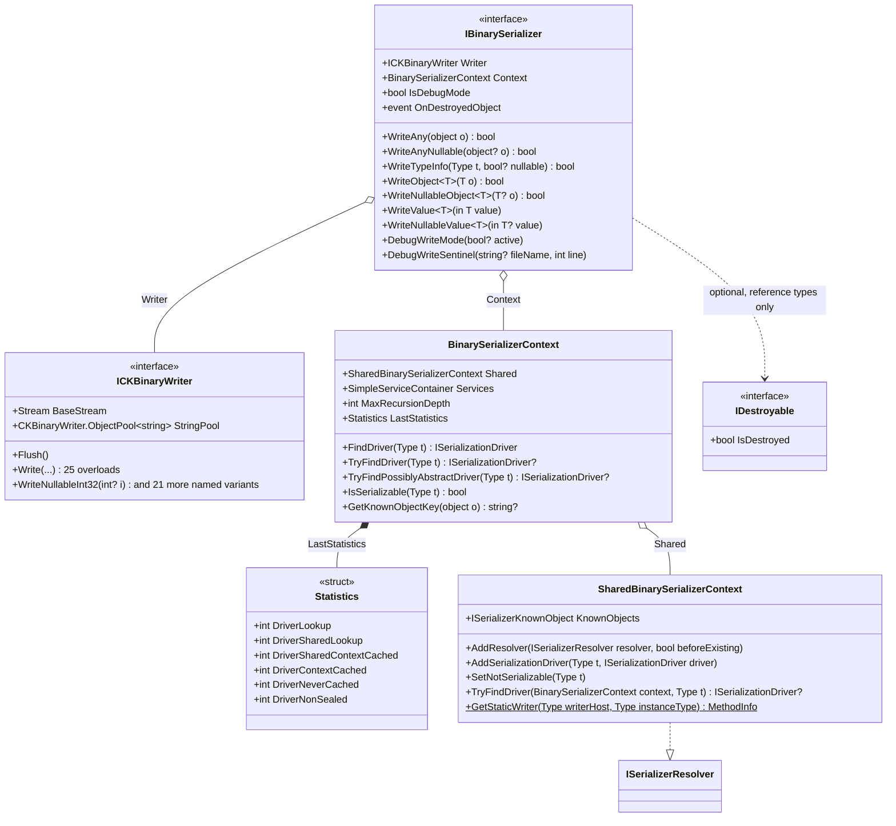

# Serialization: serializer, deserializer, contexts and drivers

This folder holds the serialization side and the shared high level API. The deserialization side and
the type mutations are described in [Deserialization](../Deserialization/README.md).

## The [IBinarySerializer](IBinarySerializer.cs)

To serialize a graph of objects, a `IDisposableBinarySerializer` must first be obtained thanks to `BinarySerializer.Create`
factory method that takes a Stream and a Context.

> [BinarySerializer](../BinarySerializer.cs) and [BinaryDeserializer](../BinaryDeserializer.cs)
> are purely static classes.

This serializes 2 lists. (Note that a User may reference one or more Books here, any references among these objects
will be preserved and restored.)
```csharp
var stream = new MemoryStream();
List<User> users = GetAllUsers();
IReadOnlyList<Book> books = GetAllBooks();
using( var s = BinarySerializer.Create( stream, new BinarySerializerContext() ) )
{
  s.WriteObject( users );
  s.WriteObject( books );
}
```
This serializer must be disposed once done with it: this ends the serialization session and release the Context.
This Context is a cache that can be reused for another (non concurrent) serialization session: the association
between a Type to serialize and its serializer is cached in a simple dictionary and subsequent runs are definitely faster.

## The [IBinaryDeserializer](../Deserialization/IBinaryDeserializer.cs)

Deserialization uses another pattern: a function must do the job. Here, since we must read back the 2 lists, we return
a value tuple with the 2 lists.
```csharp
// The stream must be correctly positioned.
stream.Position = 0;
var result = BinaryDeserializer.Deserialize( stream, new BinaryDeserializerContext(), d =>
{
  return (d.ReadObject<List<User>>(), d.ReadObject<IReadOnlyList<Book>>());
} );
Debug.Assert( result.IsValid );
Debug.Assert( result.Error == null );

var (users,books) = result.GetResult();
```
> We could also have used a closure on local variables with a `Action<IBinaryDeserializer>`
instead of the `Func<IBinaryDeserializer, T>` deserializer function but using a value tuple here is
cleaner.

Here also the `new BinaryDeserializerContext()` can be kept and reused to significantly boost subsequent
deserialization sessions.

## The Contexts and SharedContexts
[BinarySerializerContext](BinarySerializerContext.cs)
and [BinaryDeserializerContext](../Deserialization/BinaryDeserializerContext.cs) are simple
non concurrent caches that can be reused to avoid recomputing Type to [ISerializationDriver](Abstractions/ISerializationDriver.cs)
and [ITypeReadInfo](../Deserialization/TypeReadInfo/ITypeReadInfo.cs) to [IDeserializationDriver](../Deserialization/Abstractions/IDeserializationDriver.cs)
mappings and expose a `IServiceProvider`. De/Serialization can rely on available services.
Deserializers can "rebind" the deserialized objects to any external services (or other contextual objects) if needed.


These contexts are only caches: mappings definition are managed by the thread safe [SharedBinarySerializerContext](SharedBinarySerializerContext.cs)
and [SharedBinaryDeserializerContext](../Deserialization/SharedBinaryDeserializerContext.cs) that use Resolvers
([ISerializerResolver](Abstractions/ISerializerResolver.cs)
and [IDeserializerResolver](../Deserialization/Abstractions/IDeserializerResolver.cs)) and can be
configured to handle singletons, new types and type mutations.

The default shared contexts are exposed by static fields of `BinarySerializer` and `BinaryDeserializer`:

```csharp
public static readonly SharedBinarySerializerContext DefaultSharedContext = new SharedBinarySerializerContext();
```
```csharp
public static readonly SharedBinaryDeserializerContext DefaultSharedContext = new SharedBinaryDeserializerContext();
```

A shared context created with its default resolvers (`useDefaultResolvers = true`, the default) uses, in this order:
- `BasicTypesSerializerResolver` / `BasicTypesDeserializerResolver`;
- `SimpleBinarySerializerResolver` / `SimpleBinaryDeserializerResolver` (the CK.Core simple serialization contracts);
- `StandardGenericSerializerResolver` / `StandardGenericDeserializerResolver`;
- the resolvers of the CK.BinarySerialization.Sliced and CK.BinarySerialization.IPoco assemblies, when they can be
  loaded (they are looked up by name, so referencing these packages is enough).

Its known objects are `SharedSerializerKnownObject.Default` / `SharedDeserializerKnownObject.Default` unless other ones
are given.

## Handling "true" singletons

How do you serialize [DBNull.Value](https://docs.microsoft.com/en-us/dotnet/api/system.dbnull)?
Or [StringComparer.OrdinalIgnoreCase](https://docs.microsoft.com/en-us/dotnet/api/system.stringcomparer.ordinalignorecase)?

This is a more complex issue than it may appear. CK.BinarySerialization implements a basic answer by allowing to give a
name to these objects.

[SharedSerializerKnownObject](Resolvers/SharedSerializerKnownObject.cs) and
[SharedDeserializerKnownObject](../Deserialization/Resolvers/SharedDeserializerKnownObject.cs)
both expose a static `Default` property that can be used to register these "known objects".

By default, the following singletons are registered: `DBNull.Value`, `Type.Missing`, `StringComparer.Ordinal`,
`StringComparer.OrdinalIgnoreCase`, `StringComparer.InvariantCulture`, `StringComparer.InvariantCultureIgnoreCase`,
`StringComparer.CurrentCulture`,`StringComparer.CurrentCultureIgnoreCase`.

This is not perfect but it works.

## Supporting new types
### Registering a Serializer and a Deserializer
Any type can be serialized thanks to dedicated Serializers and Deserializers that can be registered in the shared contexts.

For a simple (but potentially recursive) class like this one:
```csharp
  class Node
  {
      public string? Name { get; set; }

      public Node? Parent { get; set; }
  }
```
Its serializer is a `ReferenceTypeSerializer<Node>`. The `DriverName` must be unique (but can be any string),
the `SerializationVersion` typically starts at 0 and must be incremented whenever the binary layout changes:
```csharp
  sealed class NodeSerializer : ReferenceTypeSerializer<Node>
  {
      public override string DriverName => "Node needs Node!";

      public override int SerializationVersion => 0;

      protected override void Write( IBinarySerializer s, in Node o )
      {
          s.Writer.WriteNullableString( o.Name );
          s.WriteNullableObject( o.Parent );
      }
  }
```
The `ReferenceTypeDeserializer<Node>` is even simpler:
```csharp
  sealed class NodeDeserializer : ReferenceTypeDeserializer<Node>
  {
      protected override void ReadInstance( ref RefReader r )
      {
          Debug.Assert( r.ReadInfo.Version == 0 );
          var n = new Node();
          var d = r.SetInstance( n );
          n.Name = r.Reader.ReadNullableString();
          n.Parent = d.ReadNullableObject<Node>();
      }
  }
```
Registering these deserializer and serializer in the appropriate shared contexts (quite always the default ones)
must be obviously done before any de/serialization. For default shared context, this is typically done in a type
initializer (a Type's static constructor):
```csharp
BinarySerializer.DefaultSharedContext.AddSerializationDriver( typeof( Node ), new NodeSerializer() );
BinaryDeserializer.DefaultSharedContext.AddDeserializerDriver( new NodeDeserializer() );
``` 
The type to handle must NOT already be associated to an existing driver otherwise an `InvalidOperationException` is
thrown.

These explicitly registered drivers take precedence over the ones that may be resolved by resolvers.

### Registering Resolvers
Serialization and deserialization drivers handle a specific Type. This is not enough for "Type families" like a "User" base
class that can be specialized of for generic types like a `Container<T1,T2>`. To handle such polymorphic types,
([ISerializerResolver](Abstractions/ISerializerResolver.cs)
and [IDeserializerResolver](../Deserialization/Abstractions/IDeserializerResolver.cs)) can
be used.

Resolvers have the responsibility to locate or synthesize Drivers and handle type mutations.
They can be rather simple ([BasicTypesSerializerResolver](Resolvers/BasicTypesSerializerResolver.cs))
or quite complex ([StandardGenericDeserializerResolver](../Deserialization/Resolvers/StandardGenericDeserializerResolver.cs)).

Deserialization resolvers are nearly always more complex than their serialization counterpart.

## IBinarySerializer and ICKBinaryWriter, IBinaryDeserializer and ICKBinaryReader

The `ICKBinaryWriter` and `ICKBinaryReader` are defined and implemented by `CKBinaryWriter`
and `CKBinaryReader` in CK.Core. They extend the .Net System.IO.BinaryReader/Writer classes
and provides an enriched API that reads/writes basic types like `Guid` or `DateTimeOffset` and support
nullable value types once for all.

Those are basic APIs. The CK.BinarySerialization.IBinarySerializer/Deserializer supports objects
serialization (object reference tracking, struct/class neutrality and versioning) but relies
on the basic Reader/Writer (and expose them).


`+` is public and `$` static; `<<interface>>` and `<<struct>>` give the kind of the box.

Recommended conventions are:
- Serializer is **s**: `IBinarySerializer s`
- Writer is **w**: `ICKBinaryWriter w`
- Deserializer is **d**: `IBinaryDeserializer d`
- Reader is **r**: `ICKBinaryReader r`
